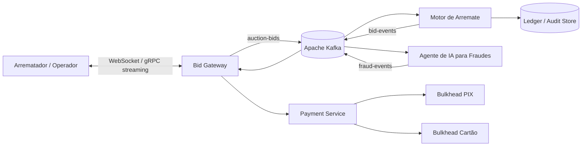

# Arquitetura C4 — Nível 2

## Container diagram

## Estratégia de ordenação

- Chave de partição: `auctionId`.
- Ordenação primária: `amount` decrescente.
- Desempate estrito: `occurredAtNs`; em caso de igualdade, `sequenceId`.
- O gateway rejeita duplicatas usando `bidId`.

## Bulkhead de pagamentos

- PIX: pool dedicado de 20 threads, timeout de 2 segundos e circuit breaker.
- Cartão: pool dedicado de 30 threads, timeout de 3 segundos e retry limitado.
- Fluxo de lance permanece independente da disponibilidade de pagamentos.
